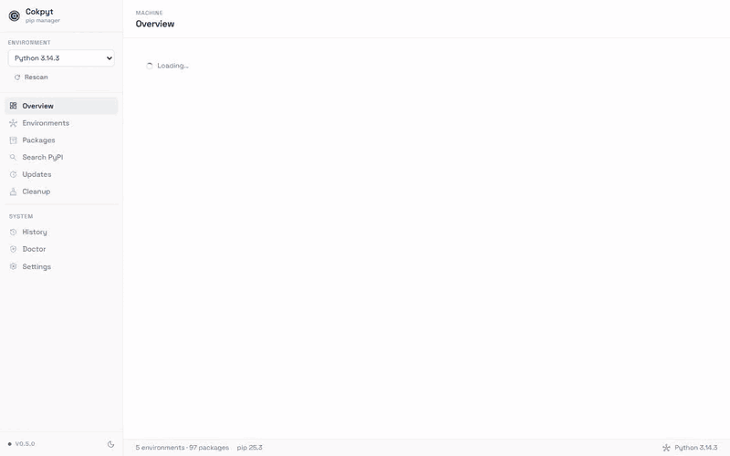

<div align="center">

<h1><strong>Cokpyt</strong></h1>
<p><em>A desktop GUI for pip. Because life is too short for the terminal.</em></p>

[](https://github.com/d3uceY/Cokpyt/releases/latest)
[](https://github.com/d3uceY/Cokpyt/releases/latest)
[](https://github.com/d3uceY/Cokpyt/releases/latest)
[](https://github.com/d3uceY/Cokpyt/releases/latest)
[](LICENSE)

<br />



</div>

---

## What is Cokpyt?

`pip list` reports the packages of one interpreter and writes them to your terminal. Cokpyt finds *every* Python environment on your machine and puts them on one dashboard: browse packages, search all of PyPI, install, upgrade and uninstall with a click, run a health check on an environment, and read a logged history of every pip action.

**Cokpyt is the GUI you always wished pip shipped with.**

It is a lightweight desktop app, built with Go and a React frontend, and it never touches the command line.

---

## Why "every environment" matters

`pip list` answers a narrower question than it looks like it does. On a machine with a launcher, a couple of runtimes and a few project venvs, the answer it gives is a fraction of the truth — and the fraction it misses is usually the one you wanted, because the packages a project actually needs live in its own environment, not in the base interpreter.

Cokpyt inventories all of them, from the only reliable source for each:

| Holder | How it is found |
|---|---|
| A runtime the `py` launcher installed | `py -0p` |
| A runtime a python.org installer dropped somewhere | scanning the usual install directories, including `%LOCALAPPDATA%\Programs\Python` and `C:\Python*` |
| A virtual environment | a `pyvenv.cfg` file at the environment root |
| A conda environment | a `conda-meta` directory at the environment root |

The sweep has **no depth limit on purpose**. A venv five levels down is normal, and a depth cap is how you get a clean-looking empty result that is simply wrong. It is bounded in *work* instead, and says so if it had to stop early.

Two traps are handled explicitly:

- **The Microsoft Store stub.** On a machine with no real Python on `PATH`, `python` resolves to a `WindowsApps` shim that opens the Store or fails with "Python was not found". A stub on `PATH` says nothing about what is installed, so Cokpyt says so and uses the environments it found.
- **Launcher shims.** The Python Install Manager keeps redirecting `python.exe` files in its `bin` directory. They answer `--version` correctly because they exec the real interpreter, but they own no packages. Cokpyt asks every interpreter where it *actually* lives and folds the shim onto its target, so you get one row per runtime instead of two.

---

## Download

Latest installer for your platform:

| Platform | Download |
|----------|----------|
| **Windows** (x64) | [](https://github.com/d3uceY/Cokpyt/releases/latest/download/Cokpyt-windows-installer.exe) |
| **macOS** (Universal) | [](https://github.com/d3uceY/Cokpyt/releases/latest/download/Cokpyt-macos-amd64.zip) |
| **Linux** (x64) | [](https://github.com/d3uceY/Cokpyt/releases/latest/download/Cokpyt-linux-amd64) |

Older versions and release notes are on the [Releases page](https://github.com/d3uceY/Cokpyt/releases).

---

## Features

- **Environments** — every interpreter and virtual environment on the machine, with the package count each one holds
- **Overview** — a live summary of the machine, plus recent activity
- **Installed Packages** — browse, filter, install, uninstall, and bulk-manage the active environment
- **Updates** — every package that is behind, with the size of the version jump
- **Search** — query PyPI and install straight from the results
- **Doctor** — checks the interpreter, its pip, and PyPI connectivity, with fix hints
- **History** — a record of every install, upgrade, and uninstall Cokpyt has run
- **Cleanup** — measure and remove pip caches, `.egg-info` directories, and `__pycache__` folders
- **Console** — pip's own output, streamed live while it works

---

## How to Use Cokpyt

### 1. Environments
The sidebar picker names the environment every other page is working in. Click it to switch, or open the **Environments** page for the full list.

Each row shows how the environment was found (`launcher`, `standalone`, `venv`, `conda`), its Python version, how many packages it holds, and where it lives. Click a row or its **Use** button to make it active; **Open** reveals it in your file manager.

Use **Scan a folder** if your projects live on another drive. **Rescan** re-inventories the machine, which you should rarely need — Cokpyt notices new environments on its own.

---

### 2. Overview

The headline numbers are deliberately about the *machine*: how many environments exist, how many packages they hold between them, and how many updates are waiting in the active environment. Below them are the environment list and recent activity.

"39 installed packages" is a true sentence about one interpreter and a misleading sentence about your computer, and that confusion is what Cokpyt exists to remove.

---

### 3. Installed Packages

A full table of everything in the active environment.

- **Filter** by name or description
- **Install** — click the blue **Install** button and type a package name; a version pin, a path or a URL all work, because pip accepts them
- **Upgrade** or **Uninstall** a single package from its row
- **Bulk uninstall** — tick several rows and use the button that appears

The **Latest** column fills in behind the list while PyPI is queried, so the page never waits on the network to render.

---

### 4. Updates

Every package in the active environment with a newer version on PyPI, showing the installed version, the latest version, and whether the jump is a major, minor or patch bump. **Upgrade** a single row, or **Upgrade all**.

Where a package publishes one, a link opens its changelog so you can see what changed before you commit.

---

### 5. Search

Type a package name and Cokpyt queries the PyPI index, with descriptions pulled from package metadata. Anything already installed is marked, and a click installs it into the active environment.

---

### 6. Doctor

Three checks for the active environment: can the interpreter run, does it have a working pip, and is PyPI reachable. Each result is **passed**, a **warning**, or a **failure**, and anything wrong comes with a concrete next step.

---

### 7. History

Every install, upgrade and uninstall Cokpyt has run, with the package, version, result and timestamp. Hover a row for the exact command. Filter by action, export the lot as CSV, or clear the record.

Only actions run from this app are listed. Anything you did in a terminal lives only in that terminal.

---

### 8. Cleanup

Cokpyt measures the pip download cache, leftover `.egg-info` directories and `__pycache__` folders, and reports what removing them would free before it deletes anything.

---

### 9. Console

Any pip operation opens a console panel at the bottom of the window and streams pip's own output as it runs. **copy** puts the whole transcript on your clipboard.

---

## Built With

- [Wails v3](https://wails.io) — Go backend, web frontend, one binary
- [React](https://react.dev) with [Vite](https://vite.dev) — components and hooks, bundled by Vite
- ES module bindings generated from the Go services by `wails3 generate bindings -b`

---

## Contributing

Found a bug, or have an idea? See [CONTRIBUTING.md](CONTRIBUTING.md).

```bash
git clone https://github.com/d3uceY/Cokpyt.git
cd Cokpyt
wails3 dev
```

```bash
wails3 task bindings              # generate the bindings the frontend imports
npm --prefix frontend run build   # build the React frontend
go test ./...                     # Go tests
```

---

## License

Cokpyt is released under the [MIT License](LICENSE).
